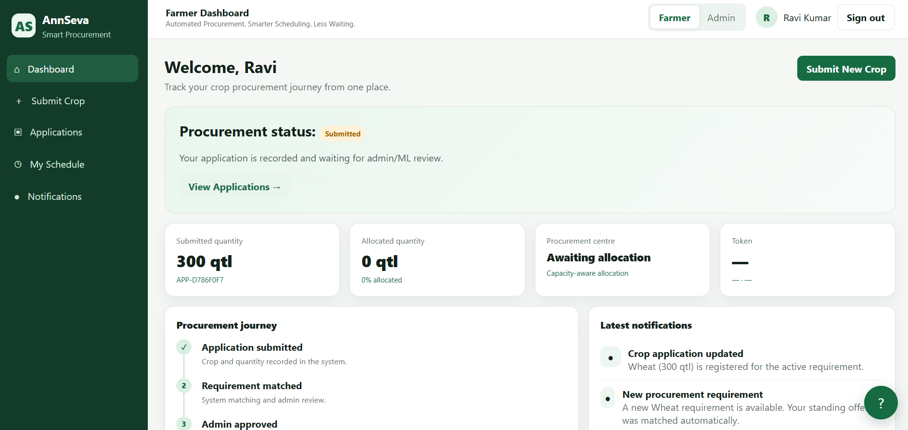
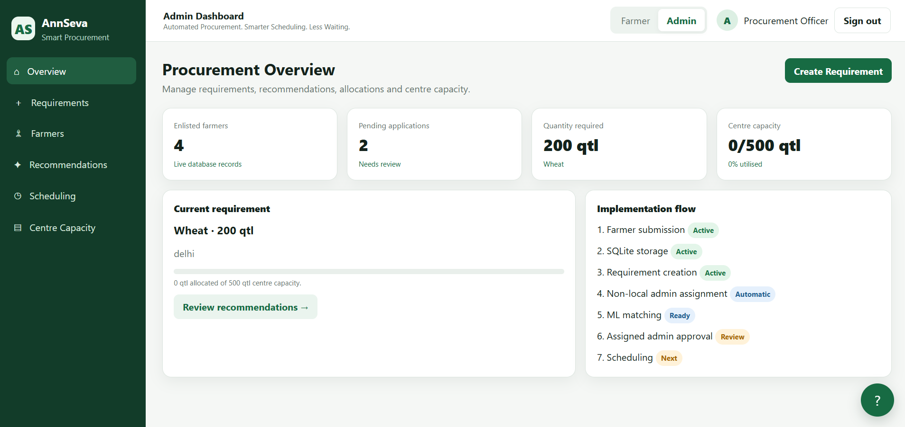
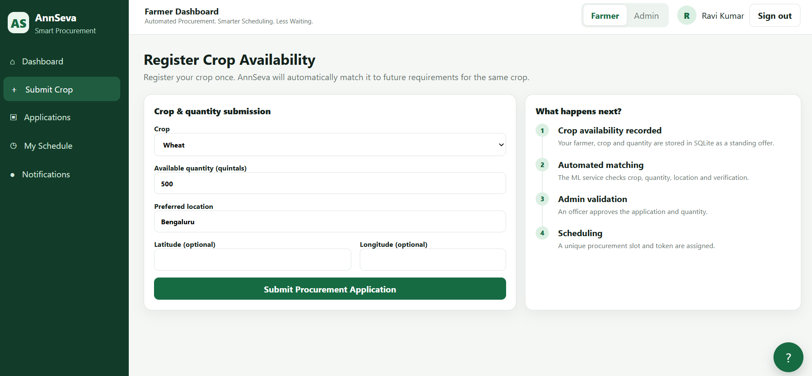
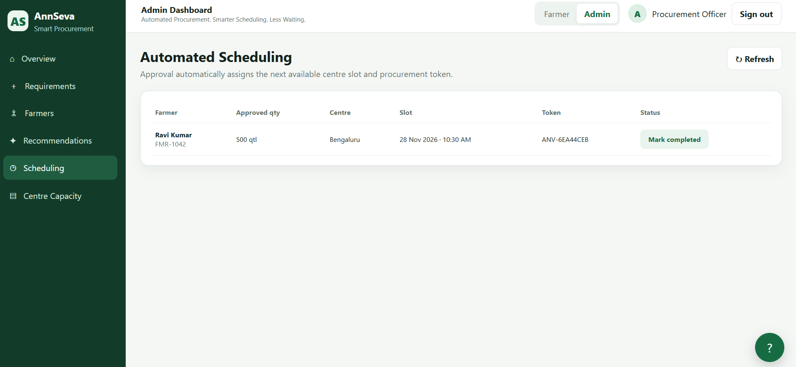
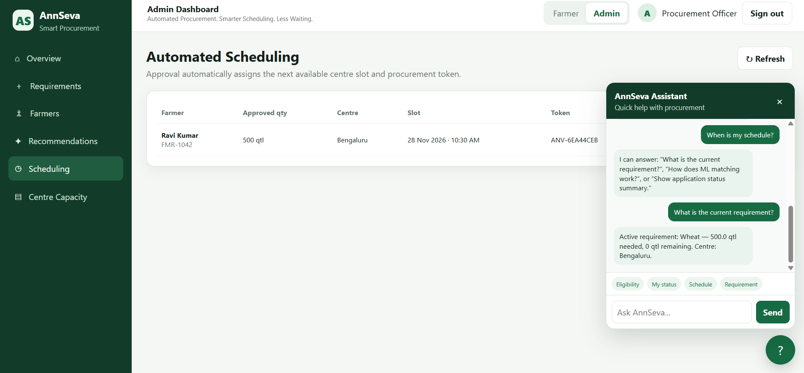

# AnnSeva – AI-Powered Agricultural Procurement System

## Overview

**AnnSeva** is an AI/ML-assisted agricultural procurement platform designed to simplify and improve the agricultural procurement process by connecting farmers, procurement administrators, and procurement centres.

The platform helps farmers submit standing crop offers and enables procurement administrators to identify suitable farmers based on crop requirements, rank recommendations, allocate procurement capacity, and schedule procurement slots.

By combining machine learning with automated procurement management, AnnSeva aims to make agricultural procurement more transparent, efficient, and organised.

## Key Features

### 1. Farmer Management
- Farmer registration and management.
- Submission of standing crop offers.
- Crop and quantity information management.
- Tracking of procurement status.

### 2. AI/ML-Based Farmer Recommendation
- Intelligent matching of farmer offers with procurement requirements.
- Machine learning-based farmer ranking.
- Random Forest-based recommendation engine.
- Data-driven procurement recommendations.

### 3. Procurement Management
- Procurement requirement management.
- Automated farmer selection assistance.
- Capacity-aware procurement allocation.
- Administrative approval workflow.

### 4. Slot Scheduling and Token Generation
- Procurement slot allocation.
- Automated token generation.
- Organised farmer scheduling.
- Reduced procurement centre congestion.

### 5. Notifications and Tracking
- Procurement status updates.
- Farmer allocation information.
- Scheduling notifications.
- Improved communication between stakeholders.

### 6. Role-Based Dashboards
- Farmer dashboard.
- Procurement administrator dashboard.
- Procurement centre management.

## Technology Stack

| Category | Technologies |
|---|---|
| Programming Language | Python |
| Backend Framework | FastAPI |
| Database | SQLite |
| Data Validation | Pydantic |
| Machine Learning | Scikit-learn |
| ML Algorithm | Random Forest |
| Data Processing | Pandas, NumPy |
| Frontend | HTML, CSS, JavaScript |
| API Communication | Fetch API |
| Server | Uvicorn |
| API Testing | Postman |
| Version Control | Git, GitHub |

## Machine Learning Implementation

AnnSeva incorporates a machine learning-based recommendation engine to assist in matching farmers with procurement requirements.

**Algorithm:** Random Forest

**Libraries:**
- Scikit-learn
- Pandas
- NumPy

**Recommendation Workflow:**

1. Collect farmer crop offer information.
2. Process and prepare the input data.
3. Analyse procurement requirements.
4. Apply the machine learning recommendation model.
5. Generate farmer recommendations and rankings.
6. Support procurement administrators in making allocation decisions.

The prototype uses synthetic data for developing and testing the recommendation engine.

## System Workflow

```text
        FARMERS
           |
           v
   Submit Crop Offers
           |
           v
   Backend Processing
           |
           v
  ML Recommendation Engine
           |
           v
  Farmer Ranking & Matching
           |
           v
  Procurement Administrator
           |
           v
     Admin Approval
           |
           v
  Capacity-Based Allocation
           |
           v
    Slot Scheduling
           |
           v
     Token Generation
           |
           v
 Farmer Notifications
```

## Project Structure

```text
AnnSeva/
│
├── server.py
├── index.html
├── annseva.db
│
├── ml/
│   ├── recommendation_engine.py
│   └── requirements.txt
│
├── backend_requirements.txt
├── README.md
│
└── assets/
    └── annseva-logo.svg
```

## Installation and Setup

### Prerequisites

Make sure you have installed:

- Python 3.9 or above
- pip
- Git

### 1. Clone the Repository

```bash
git clone <YOUR_GITHUB_REPOSITORY_URL>
```

### 2. Navigate to the Project Directory

```bash
cd AnnSeva
```

### 3. Install Backend Dependencies

```bash
pip install -r backend_requirements.txt
```

### 4. Install Machine Learning Dependencies

```bash
pip install -r ml/requirements.txt
```

### 5. Run the Application

```bash
python server.py
```

### 6. Access the Application

Open your browser and navigate to:

```text
http://127.0.0.1:8000
```

## Project Objectives

- Simplify agricultural procurement operations.
- Improve the connection between farmers and procurement centres.
- Reduce manual effort in farmer selection.
- Introduce machine learning into agricultural procurement.
- Improve procurement capacity utilisation.
- Organise procurement through scheduling and token generation.
- Increase transparency and efficiency in the procurement process.

## Future Enhancements

- Integration with government agricultural procurement systems.
- Real-time crop price integration.
- Weather-based procurement recommendations.
- Advanced machine learning recommendation models.
- SMS and WhatsApp notification integration.
- Cloud deployment and scalability.
- Integration with larger agricultural datasets.
## Application Screenshots

### 1. Farmer Dashboard


### 2. Admin Dashboard


### 3. Crop Submission


### 4. Procurement Scheduling


### 4. Rule Based Chatbot

## Project Impact

AnnSeva demonstrates how artificial intelligence, machine learning, and web technologies can be combined to address practical challenges in agricultural procurement.

The platform focuses on creating a structured procurement ecosystem where farmers receive better access to procurement opportunities and administrators can make more informed, data-driven decisions.

## Author

**AnnSeva – AI-Powered Agricultural Procurement System**

Developed as an AI/ML-based agricultural technology project.

---

*Making agricultural procurement smarter, more efficient, and more accessible through technology.*
